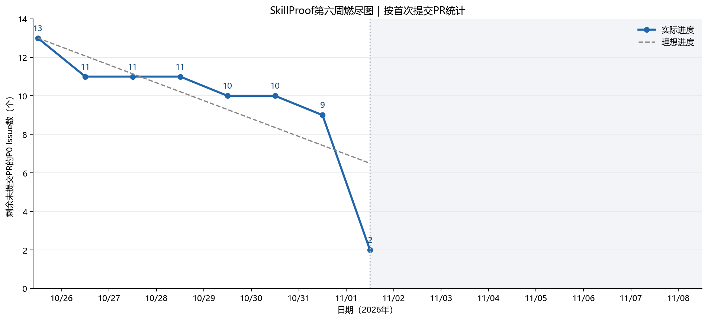
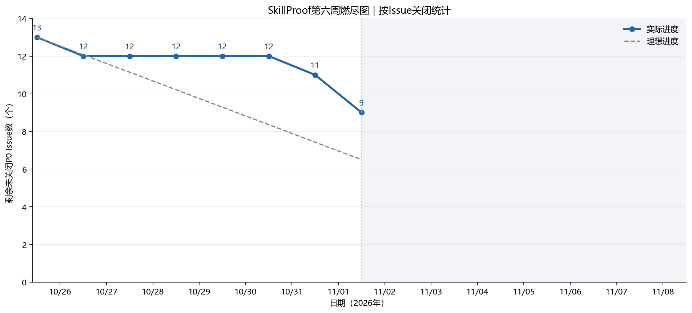
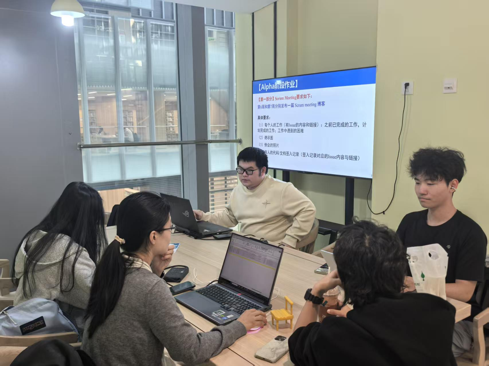

# 我们很团队——SkillProof第六周Scrum Meeting

本篇记录SkillProof Alpha两周冲刺的第一周。

项目仓库：[SkillProof-Team / SkillProof](https://github.com/SkillProof-Team/SkillProof)。

## 一、会议与冲刺安排

| 项目 | 内容 |
| --- | --- |
| 团队 | 我们很团队 |
| 项目 | SkillProof——大学生岗位基础能力画像与成长平台 |
| 例会地点及方式 | 图书馆302研讨室，线下会议 |
| 参会成员 | 付熙瑜、李宛霖、常嶅阳、冯皙丹、王斯语、王绥源，共六人 |
| 两周冲刺周期 | 2026年10月26日—11月8日 |
| 本篇进展区间 | 第一周：10月26日—11月1日 |
| 统计截止 | 2026年11月1日24:00，北京时间 |

统计以GitHub Issue关闭事件、PR合并时间和提交记录为依据。文中“已合并”表示成果进入主分支；“分支已实现”表示已有签入，但仍需联调、评审或验收。PR中的测试结果为提交者记录，本文编写时未重新运行各业务分支测试。

## 二、成员工作记录

### 1. 付熙瑜（GitHub：daybreakju9）

**之前已完成的工作**

- 完成 [#1初始化项目工程结构](https://github.com/SkillProof-Team/SkillProof/issues/1)，建立前后端工程、文档和测试目录，提供依赖、环境示例、运行说明和健康检查入口，[PR #2](https://github.com/SkillProof-Team/SkillProof/pull/2) 已合并。
- 完成 [#5后端开发能力树与首批题库](https://github.com/SkillProof-Team/SkillProof/issues/5)，建立六维能力树和42道原创选择题，补充内容契约、资料说明与自动校验，[PR #22](https://github.com/SkillProof-Team/SkillProof/pull/22) 已合并。题库为Easy 30道、Medium 12道、Hard 0道。
- 推进 [#9六维评分与结果查询](https://github.com/SkillProof-Team/SkillProof/issues/9)：在 [Draft PR #27](https://github.com/SkillProof-Team/SkillProof/pull/27) 签入独立评分函数和结果快照查询。综合分采用难度权重1 / 2 / 5，维度分采用该维度答对比例，多选题需答案集合完全一致。PR记录22项测试通过，真实业务联调尚未完成。
- 为 [#14两周Scrum与燃尽图](https://github.com/SkillProof-Team/SkillProof/issues/14) 建立第一周记录及基线，[PR #18](https://github.com/SkillProof-Team/SkillProof/pull/18) 已合并；Review并合并 [PR #21](https://github.com/SkillProof-Team/SkillProof/pull/21)、[PR #24](https://github.com/SkillProof-Team/SkillProof/pull/24) 的个人文档；在 [PR #26](https://github.com/SkillProof-Team/SkillProof/pull/26) 协助保留题库并修正初始化校验。

**计划完成的工作**

- 与 [#8测评生命周期](https://github.com/SkillProof-Team/SkillProof/issues/8)、[#6认证与岗位查询](https://github.com/SkillProof-Team/SkillProof/issues/6) 负责人接入真实数据库、会话和提交链路，完成 [#9](https://github.com/SkillProof-Team/SkillProof/issues/9) 的结果查询联调。
- 与 [#11结果页](https://github.com/SkillProof-Team/SkillProof/issues/11) 负责人确认综合分、精度、薄弱项及并列规则，统一接口文档和页面表现。
- 持续汇总 [#14](https://github.com/SkillProof-Team/SkillProof/issues/14) 两周材料，推进 [#13部署与发布验收](https://github.com/SkillProof-Team/SkillProof/issues/13) 的环境准备。#13在快照中尚未分配负责人，集成工作仍需落实认领。

**工作中遇到的困难**

评分可独立开发，但最终验收依赖真实认证、数据库和提交记录。结果页还提出岗位权重与薄弱项优先级需求，与评分分支的排序口径需进一步统一。题库没有Hard题，原“每维每难度一题”的方案无法直接执行；需与抽题负责人共同确认方案，不能由内容题量直接替代业务规则。相关依赖见 [#8](https://github.com/SkillProof-Team/SkillProof/issues/8)、[#9](https://github.com/SkillProof-Team/SkillProof/issues/9)、[PR #23](https://github.com/SkillProof-Team/SkillProof/pull/23) 和 [PR #28](https://github.com/SkillProof-Team/SkillProof/pull/28)。

### 2. 李宛霖（GitHub：7M7666）

**之前已完成的工作**

- 在 [Draft PR #19](https://github.com/SkillProof-Team/SkillProof/pull/19) 推进 [#7注册登录与岗位选择](https://github.com/SkillProof-Team/SkillProof/issues/7)，完成页面、公共组件、表单校验和路由处理，删除示例岗位数据；第一周已签入认证及岗位请求、会话恢复、请求状态和开发代理等前端实现，仍未完成真实后端联调。
- 在 [Draft PR #25](https://github.com/SkillProof-Team/SkillProof/pull/25) 推进 [#10测评答题与提交](https://github.com/SkillProof-Team/SkillProof/issues/10)，实现单选、多选、切题、答题卡、进度、未答题提示、保存与提交请求，以及重复点击保护。PR记录lint、build和差异检查通过，组件尚未接入完整页面流程。
- 通过 [PR #21](https://github.com/SkillProof-Team/SkillProof/pull/21) 将个人Scrum记录合并到主分支，关联 [#14](https://github.com/SkillProof-Team/SkillProof/issues/14)。
- Review [PR #23](https://github.com/SkillProof-Team/SkillProof/pull/23)，提出六维响应校验、并列薄弱项展示、路由整合及暂缓关闭Issue的意见，并进行了后续检查。

**计划完成的工作**

- 对接 [#6](https://github.com/SkillProof-Team/SkillProof/issues/6) 真实接口，验证注册、登录、退出、刷新恢复、会话失效、Cookie与CSRF行为，完成 [#7](https://github.com/SkillProof-Team/SkillProof/issues/7) 验收。
- 与 [#8](https://github.com/SkillProof-Team/SkillProof/issues/8) 联调创建测评、保存恢复和最终提交，将岗位入口、答题页及 [#11](https://github.com/SkillProof-Team/SkillProof/issues/11) 结果页串联，完成 [#10](https://github.com/SkillProof-Team/SkillProof/issues/10)。

**工作中遇到的困难**

页面路由分散在不同分支，登录页与结果页都修改入口，直接合并可能让 `/reports/{id}` 无法访问。答题页还依赖后端对重复创建、重复提交及持久化的约定。处理方向是先统一路由，再验证真实流程；接口调用已编写不代表联调完成。见 [PR #19](https://github.com/SkillProof-Team/SkillProof/pull/19)、[PR #23](https://github.com/SkillProof-Team/SkillProof/pull/23)、[PR #25](https://github.com/SkillProof-Team/SkillProof/pull/25)。

### 3. 常嶅阳（GitHub：Chang-aoyang）

**之前已完成的工作**

- 在 [PR #23](https://github.com/SkillProof-Team/SkillProof/pull/23) 推进 [#11能力画像与薄弱项结果页](https://github.com/SkillProof-Team/SkillProof/issues/11)，实现六维雷达图、条形图、维度明细和薄弱项展示，提供加载、未登录、结果不存在、未提交及请求失败提示。
- 签入桌面、390px手机宽度和深色模式等验证截图，补充响应字段、六维完整性、分数范围与并列展示处理。PR记录lint、build通过，页面验证使用临时mock接口；真实结果接口和统一路由尚未验收。
- 通过 [PR #24](https://github.com/SkillProof-Team/SkillProof/pull/24) 合并个人Scrum记录，关联 [#14](https://github.com/SkillProof-Team/SkillProof/issues/14)；认领 [#17历史记录、复测与结果对比](https://github.com/SkillProof-Team/SkillProof/issues/17)。

**计划完成的工作**

- 与 [#9](https://github.com/SkillProof-Team/SkillProof/issues/9) 负责人确认综合分、答对数 / 总题数、排序及并列规则，用真实 `/api/reports/{id}` 验证图表数值和异常响应。
- 在 [#7](https://github.com/SkillProof-Team/SkillProof/issues/7) 路由方案上接入结果页。核心流程稳定后，与 [#16历史测评数据支持](https://github.com/SkillProof-Team/SkillProof/issues/16) 对接，推进 [#17](https://github.com/SkillProof-Team/SkillProof/issues/17)。

**工作中遇到的困难**

早期接口仅有维度分，无法完整支持综合分和薄弱项扩展字段；当前仍需明确前后端共同采用的规则。结果页入口还受认证分支路由影响。历史对比也依赖后端数据，因此本周不将其记为已完成功能。第一周早期个人记录中的“#16暂无人认领”已有变化：抓取快照中负责人为hope3243，后续按实际认领继续协作。见 [PR #23](https://github.com/SkillProof-Team/SkillProof/pull/23)、[PR #24](https://github.com/SkillProof-Team/SkillProof/pull/24)、[#16](https://github.com/SkillProof-Team/SkillProof/issues/16)。

### 4. 冯皙丹（GitHub：Claire-Feng-9923）

**之前已完成的工作**

- 完成 [#3最小API契约](https://github.com/SkillProof-Team/SkillProof/issues/3)，提交核心接口文档，[PR #20](https://github.com/SkillProof-Team/SkillProof/pull/20) 于10月31日合并，为前后端并行开发提供约定。
- 完成 [#4数据库结构与初始化](https://github.com/SkillProof-Team/SkillProof/issues/4)，建立SQLite核心表、迁移、题库初始化及快照持久化，补充数据库设计说明与测试，[PR #26](https://github.com/SkillProof-Team/SkillProof/pull/26) 于11月1日合并。
- PR #26记录了12项数据库测试、依赖检查、后端启动和健康检查，覆盖空库初始化、重复初始化、独立进程持久化、约束、快照和回滚等场景。

**计划完成的工作**

- 继续完成 [#6账户认证与岗位查询](https://github.com/SkillProof-Team/SkillProof/issues/6)，提供注册、登录、退出、当前用户及岗位能力树接口，协助 [#7](https://github.com/SkillProof-Team/SkillProof/issues/7) 完成真实会话联调。
- 配合 [#8](https://github.com/SkillProof-Team/SkillProof/issues/8) 核对进行中测评约束、用户归属和快照字段，确保接口与数据库规则一致。

**工作中遇到的困难**

数据库初始化需要保留另一分支已合入的题库，避免覆盖内容数据；进行中测评约束也需要与后续业务行为一致。PR #26中保留题库及校验的修正体现了这一集成问题。认证相关浏览器行为还需与前端共同验证，不能仅凭后端测试判定通过。

**截止日说明：** [PR #30认证与岗位查询](https://github.com/SkillProof-Team/SkillProof/pull/30) 的首个提交为北京时间**11月2日00:48**，PR建立于00:49，属于第二周。它可作为后续进展参考，不计入第一周已交付成果，也不据此减少第一周剩余Issue。

### 5. 王斯语（GitHub：hope3243）

**之前已完成的工作**

- 在 [Draft PR #28](https://github.com/SkillProof-Team/SkillProof/pull/28) 推进 [#8测评创建、答案保存与提交](https://github.com/SkillProof-Team/SkillProof/issues/8)，签入测评创建、恢复、答案保存、提交、快照和权限校验，以及重复提交处理和评分接入点。该分支尚未合并。
- PR记录43项后端测试通过，并记录与评分实现的本地集成检查；测试使用临时数据库、会话或题库夹具，不代表真实登录与前端端到端验证完成。
- 在 [PR #22](https://github.com/SkillProof-Team/SkillProof/pull/22) 签入题库复核文档并提交APPROVED Review，完成题库PR的合并，协助 [#5](https://github.com/SkillProof-Team/SkillProof/issues/5) 交付。
- 为 [#12 Alpha测试计划、集成测试与报告](https://github.com/SkillProof-Team/SkillProof/issues/12) 提交测试计划，[PR #29](https://github.com/SkillProof-Team/SkillProof/pull/29) 在第一周末创建。此项属于跨责任域协作，#12的主负责人仍为SeanYuanWSY。

**计划完成的工作**

- 与内容负责人确认18题方案：每维2道Easy、1道Medium，明确题库不足时的处理并同步契约，完成 [#8](https://github.com/SkillProof-Team/SkillProof/issues/8) 真实认证及评分联调。
- 配合 [#12](https://github.com/SkillProof-Team/SkillProof/issues/12) 验证保存恢复、越权、未答完、重复与并发提交；P0稳定后推进已认领的 [#15学习建议](https://github.com/SkillProof-Team/SkillProof/issues/15)、[#16历史测评数据支持](https://github.com/SkillProof-Team/SkillProof/issues/16)。

**工作中遇到的困难**

题库缺少Hard题，原抽题蓝图不可直接实现，当前分支方案尚需内容负责人确认。最终提交还需把状态、时间与评分结果一致保存；失败不能丢草稿，重复提交不能重复评分。这些行为需要真实依赖下的联调，详见 [PR #28](https://github.com/SkillProof-Team/SkillProof/pull/28)。

PR#29已重新打开，尚未合并。第一周已完成测试计划签入，后续继续通过该PR推进评审与合并；测试计划提交不代表#12的集成测试和最终测试报告已全部完成。

### 6. 王绥源（GitHub：SeanYuanWSY）

**之前已完成的工作**

- 承担 [#12测试计划、集成测试与报告](https://github.com/SkillProof-Team/SkillProof/issues/12) 的QA责任。仓库主分支记录显示，本周以WangSuiYuan / SeanYuanWSY身份执行了 [PR #2](https://github.com/SkillProof-Team/SkillProof/pull/2) 与 [PR #18](https://github.com/SkillProof-Team/SkillProof/pull/18) 的合并，分别关联 [#1](https://github.com/SkillProof-Team/SkillProof/issues/1) 工程初始化和 [#14](https://github.com/SkillProof-Team/SkillProof/issues/14) Scrum记录。
- 这两项贡献体现为协作合并记录。快照中未找到其署名的独立业务代码或测试报告提交，因此不将其他成员提交的测试计划、题库复核或业务代码记在其名下。

**计划完成的工作**

- 按 [#12](https://github.com/SkillProof-Team/SkillProof/issues/12) 完善测试计划，协调使用已有计划稿，覆盖注册到结果页的核心场景、错误输入、权限、刷新和重复提交。
- 随模块合并执行测试，记录版本、环境、步骤、实际结果；真实缺陷单独建Bug Issue，修复后复测，最终形成测试报告并配合 [#13](https://github.com/SkillProof-Team/SkillProof/issues/13) 验收。

**工作中遇到的困难**

从QA任务依赖看，认证、测评、评分及结果页尚未形成可验收的主分支完整链路，完整端到端测试仍受阻。现有仓库证据不足以确认其个人已经执行的测试数量和个人困难陈述，因此本节只说明可核实的合并贡献及任务阻塞，不宣称测试已通过。成员可在后续增量记录中补充实际执行证据。见 [#12](https://github.com/SkillProof-Team/SkillProof/issues/12)、[PR #29](https://github.com/SkillProof-Team/SkillProof/pull/29)。

## 三、每人的代码 / 文档签入记录

| 成员 | Commit | 签入内容 | 对应Issue | PR / 状态 |
| --- | --- | --- | --- | --- |
| 付熙瑜 | [5061122](https://github.com/SkillProof-Team/SkillProof/commit/50611224fab5e8142b89e014e4c73091bd28fa0b) | 初始化前后端工程与运行说明 | [#1](https://github.com/SkillProof-Team/SkillProof/issues/1) | [#2](https://github.com/SkillProof-Team/SkillProof/pull/2)；已合并 |
| 付熙瑜 | [04c0fb3](https://github.com/SkillProof-Team/SkillProof/commit/04c0fb34060c55f89f31237bc7b83a462597235b) | 建立Scrum记录与燃尽基线 | [#14](https://github.com/SkillProof-Team/SkillProof/issues/14) | [#18](https://github.com/SkillProof-Team/SkillProof/pull/18)；已合并 |
| 付熙瑜 | [e4126e2](https://github.com/SkillProof-Team/SkillProof/commit/e4126e22fda8c8bb5c8bea3e84640f7583d6edf3) | 六维能力树与42道题库 | [#5](https://github.com/SkillProof-Team/SkillProof/issues/5) | [#22](https://github.com/SkillProof-Team/SkillProof/pull/22)；已合并 |
| 付熙瑜 | [fcafe3b](https://github.com/SkillProof-Team/SkillProof/commit/fcafe3b7d41f042900714b9b4f85bfa667590386) | 对齐题库与数据库初始化校验 | [#4](https://github.com/SkillProof-Team/SkillProof/issues/4) | [#26](https://github.com/SkillProof-Team/SkillProof/pull/26)；已合并 |
| 付熙瑜 | [64474d4](https://github.com/SkillProof-Team/SkillProof/commit/64474d43c56e19d4f1c00d97e94e45ab9273c2fc) | 难度加权评分及结果查询 | [#9](https://github.com/SkillProof-Team/SkillProof/issues/9) | [#27](https://github.com/SkillProof-Team/SkillProof/pull/27)；Draft，未合并 |
| 李宛霖 | [bc4756d](https://github.com/SkillProof-Team/SkillProof/commit/bc4756d7665e22a5052c5123cf8418cf4d125f3e) | 登录页与布局 | [#7](https://github.com/SkillProof-Team/SkillProof/issues/7) | [#19](https://github.com/SkillProof-Team/SkillProof/pull/19)；Draft，未合并 |
| 李宛霖 | [d4893ed](https://github.com/SkillProof-Team/SkillProof/commit/d4893eda638cdb80a04bfa707a57f0a7bac5db12) | 页面拆分、注册及岗位页面 | [#7](https://github.com/SkillProof-Team/SkillProof/issues/7) | [#19](https://github.com/SkillProof-Team/SkillProof/pull/19)；Draft，未合并 |
| 李宛霖 | [e4ec2c2](https://github.com/SkillProof-Team/SkillProof/commit/e4ec2c2355d35125b4196b613e728e608e0a3e8b) | 认证与岗位选择前端流程 | [#7](https://github.com/SkillProof-Team/SkillProof/issues/7) | [#19](https://github.com/SkillProof-Team/SkillProof/pull/19)；Draft，未合并 |
| 李宛霖 | [304ef85](https://github.com/SkillProof-Team/SkillProof/commit/304ef852d635ed5b0cc3b66f8b75edd81574dd17) | 测评答题与提交前端逻辑 | [#10](https://github.com/SkillProof-Team/SkillProof/issues/10) | [#25](https://github.com/SkillProof-Team/SkillProof/pull/25)；Draft，未合并 |
| 李宛霖 | [208b3cd](https://github.com/SkillProof-Team/SkillProof/commit/208b3cd8db527297ceb3f46a4f275483106978d6) | 改进答题流程 | [#10](https://github.com/SkillProof-Team/SkillProof/issues/10) | [#25](https://github.com/SkillProof-Team/SkillProof/pull/25)；Draft，未合并 |
| 李宛霖 | [97609b4](https://github.com/SkillProof-Team/SkillProof/commit/97609b44f2acf96fe1ed653fd129fddff7c772c5) | 个人Scrum记录 | [#14](https://github.com/SkillProof-Team/SkillProof/issues/14) | [#21](https://github.com/SkillProof-Team/SkillProof/pull/21)；已合并 |
| 常嶅阳 | [fd59abe](https://github.com/SkillProof-Team/SkillProof/commit/fd59abe95d252c8df4ecdafe92afdff0486ac2a7) | 结果页、雷达图与薄弱项 | [#11](https://github.com/SkillProof-Team/SkillProof/issues/11) | [#23](https://github.com/SkillProof-Team/SkillProof/pull/23)；未合并 |
| 常嶅阳 | [b275ce4](https://github.com/SkillProof-Team/SkillProof/commit/b275ce484c9643a85ecc7e7c8ec37d978b04211c) | 结果页验证截图 | [#11](https://github.com/SkillProof-Team/SkillProof/issues/11) | [#23](https://github.com/SkillProof-Team/SkillProof/pull/23)；未合并 |
| 常嶅阳 | [70bdabe](https://github.com/SkillProof-Team/SkillProof/commit/70bdabeb7121f88564dbd0f05e24a4b90981675d) | 响应校验与并列薄弱项展示 | [#11](https://github.com/SkillProof-Team/SkillProof/issues/11) | [#23](https://github.com/SkillProof-Team/SkillProof/pull/23)；未合并 |
| 常嶅阳 | [7294ec2](https://github.com/SkillProof-Team/SkillProof/commit/7294ec26b7ea35ec70e6b30d76d2272dec83812c) | 个人Scrum记录 | [#14](https://github.com/SkillProof-Team/SkillProof/issues/14) | [#24](https://github.com/SkillProof-Team/SkillProof/pull/24)；已合并 |
| 冯皙丹 | [bae6a61](https://github.com/SkillProof-Team/SkillProof/commit/bae6a61e074e2ebbd50670244d2815a0de51b5e3) | 最小API契约文档 | [#3](https://github.com/SkillProof-Team/SkillProof/issues/3) | [#20](https://github.com/SkillProof-Team/SkillProof/pull/20)；已合并 |
| 冯皙丹 | [1cbc3b0](https://github.com/SkillProof-Team/SkillProof/commit/1cbc3b0239f19c32d984da87cebba4c6dd506e68) | SQLite结构与初始化 | [#4](https://github.com/SkillProof-Team/SkillProof/issues/4) | [#26](https://github.com/SkillProof-Team/SkillProof/pull/26)；已合并 |
| 王斯语 | [870001c](https://github.com/SkillProof-Team/SkillProof/commit/870001ceb3cc6ae5c718f4dd8ab48e5f3538d169) | 测评创建、保存和提交 | [#8](https://github.com/SkillProof-Team/SkillProof/issues/8) | [#28](https://github.com/SkillProof-Team/SkillProof/pull/28)；Draft，未合并 |
| 王斯语 | [364def2](https://github.com/SkillProof-Team/SkillProof/commit/364def2fddad8d701a14114e965b06bcfda2b40a) | 题库复核文档 | [#5](https://github.com/SkillProof-Team/SkillProof/issues/5) | [#22](https://github.com/SkillProof-Team/SkillProof/pull/22)；已合并 |
| 王斯语 | [e221ac5](https://github.com/SkillProof-Team/SkillProof/commit/e221ac57f255bf654984cbb7cc09c06bc2c327e4) | Alpha测试计划 | [#12](https://github.com/SkillProof-Team/SkillProof/issues/12) | [#29](https://github.com/SkillProof-Team/SkillProof/pull/29)；第一周签入，PR已重新打开，尚未合并 |
| 王绥源 | [5b4b041](https://github.com/SkillProof-Team/SkillProof/commit/5b4b0415dc4a73c903ff17bd8f2411e8aae5be4c) | 合并工程初始化PR（合并者贡献） | [#1](https://github.com/SkillProof-Team/SkillProof/issues/1) | [#2](https://github.com/SkillProof-Team/SkillProof/pull/2)；已合并 |
| 王绥源 | [a11ca09](https://github.com/SkillProof-Team/SkillProof/commit/a11ca095060c8fbb925198ee927cd9b24ed2dbe3) | 合并Scrum初始记录PR（合并者贡献） | [#14](https://github.com/SkillProof-Team/SkillProof/issues/14) | [#18](https://github.com/SkillProof-Team/SkillProof/pull/18)；已合并 |

## 四、燃尽图

### 1.按首次提交PR统计

纵坐标为**剩余未提交PR的P0 Issue数**。横坐标保持两周（10月26日—11月8日），仅绘制第一周数据。

### 每日数据

| 日期 | 当日首次有PR覆盖的Issue | 剩余未提交PR的Issue数 |
| --- | --- | ---: |
| 冲刺起始基线 | 包含#1初始化任务，共13项 | 13 |
| 10月26日 | [#1](https://github.com/SkillProof-Team/SkillProof/issues/1)（[PR#2](https://github.com/SkillProof-Team/SkillProof/pull/2)）、[#14](https://github.com/SkillProof-Team/SkillProof/issues/14)（[PR#18](https://github.com/SkillProof-Team/SkillProof/pull/18)） | 11 |
| 10月27日 | 无 | 11 |
| 10月28日 | 无 | 11 |
| 10月29日 | [#7](https://github.com/SkillProof-Team/SkillProof/issues/7)（[PR#19](https://github.com/SkillProof-Team/SkillProof/pull/19)） | 10 |
| 10月30日 | 无 | 10 |
| 10月31日 | [#3](https://github.com/SkillProof-Team/SkillProof/issues/3)（[PR#20](https://github.com/SkillProof-Team/SkillProof/pull/20)） | 9 |
| 11月1日 | [#5](https://github.com/SkillProof-Team/SkillProof/issues/5)、[#11](https://github.com/SkillProof-Team/SkillProof/issues/11)、[#10](https://github.com/SkillProof-Team/SkillProof/issues/10)、[#4](https://github.com/SkillProof-Team/SkillProof/issues/4)、[#9](https://github.com/SkillProof-Team/SkillProof/issues/9)、[#8](https://github.com/SkillProof-Team/SkillProof/issues/8)、[#12](https://github.com/SkillProof-Team/SkillProof/issues/12)（分别对应PR#22、#23、#25、#26、#27、#28、#29） | 2 |

第一周末，13项P0任务中已有**11项至少提交过一个关联PR**，剩余未提交的为[#6认证与岗位查询](https://github.com/SkillProof-Team/SkillProof/issues/6)和[#13部署与发布验收](https://github.com/SkillProof-Team/SkillProof/issues/13)。#6的PR#30于11月2日创建，属于第二周，不提前计入。

第一周累计提交**13个PR：7个已合并、6个待合并**；按Issue关闭口径仍为4项已关闭、9项未关闭。两个数字分别体现提交进度和验收进度，已有提交的工作会在本图直接体现。

### 2.按Issue关闭统计

本图纵坐标为**剩余未关闭P0 Issue数**，反映验收交付进度。

两张图横轴均为10月26日—11月8日，只绘制第一周数据；起始点为13项约定基线，其余点为每日结束时的统计，日期标签位于日内中央，第二周区域留白。理想线按13项在14天内均匀消减计算，也只显示第一周。

按首次提交PR统计，第一周末剩余2项，体现已有11项任务提交过成果；按Issue关闭统计，第一周末剩余9项，体现已有4项完成关单。两张图共同说明已提交的开发工作与完成验收的交付情况。

## 五、例会照片

图书馆302研讨室线下例会

## 六、下阶段安排与软工实践体会

以下安排根据当前情况整理，供第二周执行和验收时使用。

| 优先顺序 | 具体安排 | 对应任务与协作成员 |
| --- | --- | --- |
| 1 | 对齐认证接口、Cookie / CSRF、数据库和进行中测评约束，先让真实账户与岗位流程可用 | [#6](https://github.com/SkillProof-Team/SkillProof/issues/6)、[#7](https://github.com/SkillProof-Team/SkillProof/issues/7)；冯皙丹、李宛霖 |
| 2 | 确认18题抽题方案、评分规则和结果快照字段，接通真实提交与查询 | [#8](https://github.com/SkillProof-Team/SkillProof/issues/8)、[#9](https://github.com/SkillProof-Team/SkillProof/issues/9)；王斯语、付熙瑜 |
| 3 | 统一路由，接通岗位—答题—结果页，核对六维数值、薄弱项及异常表现 | [#10](https://github.com/SkillProof-Team/SkillProof/issues/10)、[#11](https://github.com/SkillProof-Team/SkillProof/issues/11)；李宛霖、常嶅阳，后端成员配合 |
| 4 | 执行集成与回归测试，记录缺陷、复测和未执行项，再准备发布验收 | [#12](https://github.com/SkillProof-Team/SkillProof/issues/12)、[#13](https://github.com/SkillProof-Team/SkillProof/issues/13)；王绥源统筹QA，付熙瑜协调集成，具体认领持续更新 |
| 5 | 持续按周合并Scrum材料；P0稳定后再扩展学习建议与历史对比 | [#14](https://github.com/SkillProof-Team/SkillProof/issues/14) 全员；[#15](https://github.com/SkillProof-Team/SkillProof/issues/15)、[#16](https://github.com/SkillProof-Team/SkillProof/issues/16) 王斯语，[#17](https://github.com/SkillProof-Team/SkillProof/issues/17) 常嶅阳 |

第一周最直接的体会是：**接口契约需要随实现共同维护**。有了最小契约，前后端能够并行开始；抽题难度、综合分、薄弱项等规则出现变化后，又必须同步实现、示例与说明，否则各分支单独工作正常，合并后仍会不一致。

第二，**评审和真实验收是交付的一部分**。结果页评审发现了路由覆盖、响应校验和并列展示问题；将未验收PR从 `Closes` 调整为 `Refs`，也避免了提前关闭任务。测试夹具和mock能支持局部验证，真实用户从注册到查看结果的完整链路仍要单独执行。

本篇是我们团队第一次博客。第七周Scrum、完整Alpha测试报告及阶段汇总体会按后续真实进展独立补充。
