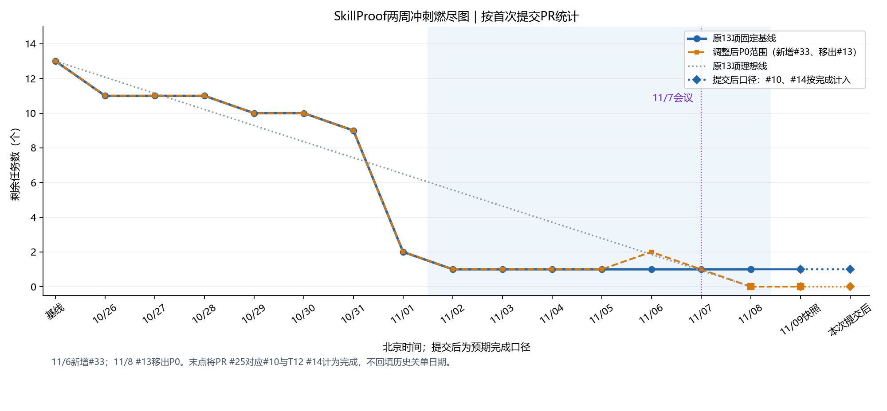
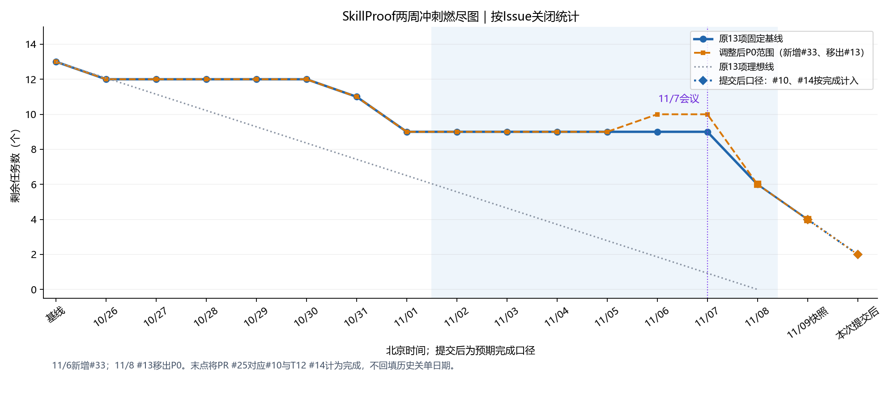
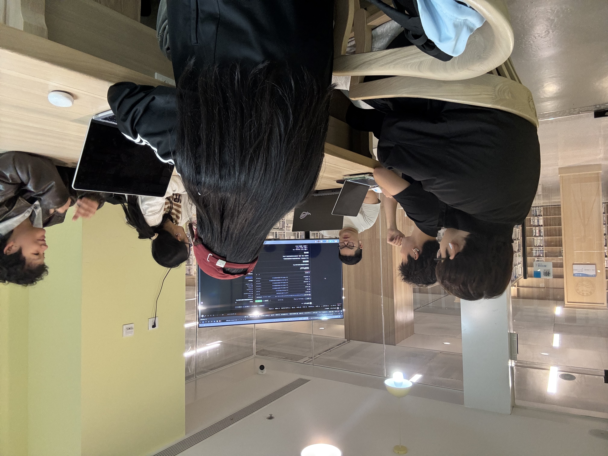

# 我们很团队——SkillProof第七周Scrum Meeting

本篇记录SkillProof Alpha两周冲刺的第二周，并补充截至11月9日的最新交付进度。

项目仓库：[SkillProof-Team / SkillProof](https://github.com/SkillProof-Team/SkillProof)。

## 一、会议与冲刺安排

| 项目 | 内容 |
| --- | --- |
| 团队 | 我们很团队 |
| 项目 | SkillProof——大学生岗位基础能力画像与成长平台 |
| 会议日期 | 2026年11月7日 |
| 会议材料 | 本篇第五节所附现场照片 |
| 团队成员 | 付熙瑜、李宛霖、常嶅阳、冯皙丹、王斯语、王绥源 |
| 两周冲刺周期 | 2026年10月26日—11月8日 |
| 第二周进展区间 | 11月2日—11月8日 |
| 最新进度快照 | 2026年11月9日20:27，北京时间 |

会议日期由团队提供。以下工作进度根据GitHub提交、PR、Issue事件和Review整理；11月8日及9日的成果属于会后更新，不倒记为11月7日会议时已完成。成员计划根据当前阻塞整理，提交前仍需本人确认。文中测试数量来自相应PR和验证记录，本篇整理时未重新运行业务测试。

11月7日结束时，测试计划PR #31和工程检查PR #34已合并，认证、评分、测评生命周期和前端核心页面仍在推进。随后，11月8日合入三个后端功能及QA登记机制，11月9日合入登录岗位页和结果页。当前答题流程PR #25仍为Draft，正式题库发布与最终回归尚未完成，不能据此宣布整个Alpha已经交付。

## 二、成员工作记录

### 1. 付熙瑜（GitHub：daybreakju9）

**之前已完成的工作**

- 在第一周评分实现的基础上推进[#9六维评分与结果查询](https://github.com/SkillProof-Team/SkillProof/issues/9)，将报告查询接入统一SQLite和真实会话；本人已提交结果读取保存快照，不随当前题库变化。综合分按难度1 / 2 / 5加权，维度分按实际题数计算，多选题答案集合完全一致才得分。
- 与结果页负责人确认综合分、精度及薄弱项顺序，补充T06调用与事务契约。11月8日推送`7907e7c`，PR记录后端49项测试及依赖检查通过；[PR #27](https://github.com/SkillProof-Team/SkillProof/pull/27)经常嶅阳批准后于当日21:23合并，#9关闭。
- 协调主分支集成：11月7日合并测试计划[PR #31](https://github.com/SkillProof-Team/SkillProof/pull/31)与工程检查[PR #34](https://github.com/SkillProof-Team/SkillProof/pull/34)；11月8日审核并合并认证[PR #30](https://github.com/SkillProof-Team/SkillProof/pull/30)、测评生命周期[PR #28](https://github.com/SkillProof-Team/SkillProof/pull/28)，合并QA登记[PR #37](https://github.com/SkillProof-Team/SkillProof/pull/37)。
- 在PR #30中补充Windows默认cp936编码下的复核：24项后端测试、38项真实HTTP检查通过，并回测旧提交复现姓名和编码问题。审核PR #28时发现抽题实现与共享契约不一致，要求同步文档，修订后批准。
- 认领[#13部署与发布验收](https://github.com/SkillProof-Team/SkillProof/issues/13)。11月8日评论说明服务器、域名已准备，但ICP备案仍在审核；任务保持Open、暂缓公网部署，标签由P0调整为P2。

**计划完成的工作**

- 协调题库复核状态、有效来源和正式发布，配合PR #25在默认题库上重跑完整链路。
- 汇总两周Scrum材料、核对六名成员记录，推进[#14](https://github.com/SkillProof-Team/SkillProof/issues/14)评审与验收。
- 在备案完成及其余阻塞消除后恢复#13，完成干净环境启动、演示回归、发布清单和Alpha Release。

**工作中遇到的困难**

后端功能分散在多个分支，报告接口既要复用真实会话，也要读取提交时的同一数据库。处理时先明确评分函数与事务边界，再依次合入认证、评分和测评流程。抽题规则也在Review中发现文档落后于实现，最终统一为六维各2道Easy、1道Medium。部署方面的备案阻塞仍未解除，调整优先级只改变安排，不代表完成。证据见[PR #30复核讨论](https://github.com/SkillProof-Team/SkillProof/pull/30)、[PR #28评审](https://github.com/SkillProof-Team/SkillProof/pull/28)及[#13](https://github.com/SkillProof-Team/SkillProof/issues/13)。

### 2. 李宛霖（GitHub：vincolee；第一周记录使用7M7666）

**之前已完成的工作**

- 完善[#7注册登录与岗位选择](https://github.com/SkillProof-Team/SkillProof/issues/7)，接入真实认证、Cookie、CSRF、会话恢复和岗位能力树；修复访客刷新注册页被跳回登录页，以及纯组合重音姓名未被前端拦截的问题。冯皙丹于11月8日复测并APPROVED；会后补充QA登记，11月9日[PR #19](https://github.com/SkillProof-Team/SkillProof/pull/19)合并、#7关闭。
- PR #19记录11月8日临时集成环境的16项HTTP、22项浏览器检查，以及11月9日T05必测8/8通过；明确这些属于不同轮次和范围，未将接口检查代替全部页面验收。
- 继续推进[#10测评答题与提交](https://github.com/SkillProof-Team/SkillProof/issues/10)：串联创建或恢复、单选多选、切题、进度、保存刷新、未答提示及离开提醒；提交前先保存，未知提交结果通过查询服务端状态恢复。
- **11月9日最新更新：** 同步包含结果页的main，删除结果占位并接入真实`ResultPage`。PR #25记录后端75项、QA18项、独立HTTP24项及Chromium流程验证；使用隔离数据库中的草稿副本，正式题库创建仍返回503。[PR #25](https://github.com/SkillProof-Team/SkillProof/pull/25)继续保持Draft，未合并。
- 参与[PR #23](https://github.com/SkillProof-Team/SkillProof/pull/23)复审，提出非法报告URL白屏、切换报告残留旧数据、薄弱项排序精度问题；修复后于11月9日批准并合并。第七周个人文档[PR #36](https://github.com/SkillProof-Team/SkillProof/pull/36)仍Open，依赖PR #35。

**计划完成的工作**

- 在正式题库完成复核、补齐来源并发布后，用默认题库重新验收PR #25，完成另一名成员Review后再合并。
- 补齐PR #19仍未执行的岗位加载、空catalog和独立请求失败重试等页面动态场景；跟进最终主分支流程回归。
- 按PR #35的合并情况整理个人文档分支和目标分支，避免重复覆盖队友记录。

**工作中遇到的困难**

页面选择状态与服务端已保存答案需要分别维护，保存失败、断网或提交响应丢失时不能错误提示成功。另一个协作点是登录、答题和结果页共同修改路由；按#19、#23先后合入，再由#25同步整合，避免互相覆盖。正式题库仍为draft，当前隔离数据上的完整流程通过不等于默认环境可用。来源见[PR #25](https://github.com/SkillProof-Team/SkillProof/pull/25)、[PR #19](https://github.com/SkillProof-Team/SkillProof/pull/19)、[个人记录PR #36](https://github.com/SkillProof-Team/SkillProof/pull/36)。

### 3. 常嶅阳（GitHub：Chang-aoyang）

**之前已完成的工作**

- 将[#11结果页](https://github.com/SkillProof-Team/SkillProof/issues/11)对齐真实报告契约：综合分直接使用后端值，校验六维统计一致性，薄弱项沿用服务端顺序，移除对未实现岗位权重、优先级的依赖。
- 区分401与403提示，修复390px视口长元信息溢出，补充桌面、手机和异常状态证据；在临时集成分支组合认证、测评、评分及前端，记录73项后端测试和真实HTTP、Cookie、CSRF、SQLite到浏览器结果页的验证。隔离库临时发布测试题，没有修改正式题库。
- **11月9日最新更新：** 根据李宛霖复审，修复非法编码URL白屏、切换报告旧数据残留和四舍五入造成的排序差异，采用`correct / total`精确比例比较；同步登录路由并登记验收测试。[PR #23](https://github.com/SkillProof-Team/SkillProof/pull/23)于当日18:29合并，#11于18:30关闭。
- 在[PR #27](https://github.com/SkillProof-Team/SkillProof/pull/27)确认评分展示规则并APPROVED，协助后端评分功能合并；提交第七周个人记录[PR #35](https://github.com/SkillProof-Team/SkillProof/pull/35)，当前仍Open。

**计划完成的工作**

- 配合PR #25和正式题库发布后的最终结果页回归，核对报告ID、图表和异常状态。
- 跟进[#16历史数据](https://github.com/SkillProof-Team/SkillProof/issues/16)契约及前置流程，随后推进已认领的[#17历史、复测与结果对比](https://github.com/SkillProof-Team/SkillProof/issues/17)。

**工作中遇到的困难**

薄弱项按显示时的两位小数排序可能与后端原始比例不同，现改为精确比较。路由整合需要等待#19进入main后同步，已于11月9日完成当前结果页交付。历史与对比功能仍依赖后端接口，当前快照未发现#16、#17关联的实现PR，不写成已完成功能。来源见[PR #23评审与修复](https://github.com/SkillProof-Team/SkillProof/pull/23)、[PR #35个人记录](https://github.com/SkillProof-Team/SkillProof/pull/35)。

### 4. 冯皙丹（GitHub：Claire-Feng-9923）

**之前已完成的工作**

- 在第一周API与数据库基础上，推进[#6账户认证与岗位查询](https://github.com/SkillProof-Team/SkillProof/issues/6)，实现注册、登录、退出、当前用户、岗位与能力树接口，供前端和测评后端复用。
- 处理李宛霖11月2日联调发现的两项问题：拒绝纯零宽姓名，测试读取能力树时显式使用UTF-8。11月7日提交`8516c23`，评论记录macOS后端24项测试通过；付熙瑜随后补充Windows复核，两个旧问题均确认修复。
- 同步main并解决测试依赖文件冲突，保留完整依赖锁定。[PR #30](https://github.com/SkillProof-Team/SkillProof/pull/30)于11月8日20:11经付熙瑜批准合并，#6关闭。PR正文仍保留早期23项测试，最新24项及平台范围以评论记录为准。
- 参与PR #28接口核对，确认报告查询复用会话、按测评及用户ID查询并读取已存结果；指出注释中的任务编号笔误。复测PR #19注册页与姓名校验，11月8日APPROVED，并于11月9日合并该前端PR。

**计划完成的工作**

- 配合默认题库、答题页面和最终主分支的认证、会话及岗位回归，跟进跨平台问题。
- 协助维护真实接口与数据库约定，确保后续历史、复测等功能保持用户数据隔离。

**工作中遇到的困难**

Windows默认编码与macOS不同，测试不能依赖系统默认解码；姓名合法性也不能只按字符串长度判断。通过明确UTF-8读取、补充不可见字符校验及跨平台复核解决。合并时测试依赖清单出现add/add冲突，已在同步main时处理。来源见[PR #30讨论与修复](https://github.com/SkillProof-Team/SkillProof/pull/30)、[PR #19审核](https://github.com/SkillProof-Team/SkillProof/pull/19)。

### 5. 王斯语（GitHub：hope3243）

**之前已完成的工作**

- 推进[#8测评生命周期](https://github.com/SkillProof-Team/SkillProof/issues/8)，实现创建、恢复、草稿保存和最终提交；保持题目与结果快照、用户归属检查、重复与并发提交只评分一次，以及评分失败保留草稿。
- 11月8日凌晨在[PR #28](https://github.com/SkillProof-Team/SkillProof/pull/28)报告临时分支联调73项后端测试及1项联调检查通过；认证和评分合并后再次同步main，记录后端75项、QA10项，以及真实登录、保存、提交和报告查询验证。
- 根据Review同步四份文档，确认抽题版本`alpha-18-easy12-medium6-v1`：六维各2道Easy、1道Medium，共18题；只抽published题，题量不足返回503。该方案已不要求每维必须有Hard题。[PR #28](https://github.com/SkillProof-Team/SkillProof/pull/28)于11月8日23:34合并，#8于23:37关闭。
- 推进[#12测试计划](https://github.com/SkillProof-Team/SkillProof/issues/12)协作：早期PR #29关闭后，改由[PR #31](https://github.com/SkillProof-Team/SkillProof/pull/31)交付同一测试计划，11月7日合并。只统计一次成果；计划进入main不代表最终测试报告已验收。

**计划完成的工作**

- 配合正式发布题库和PR #25进行浏览器完整链路回归，复核并发、回滚和权限边界。
- P0稳定后推进已认领的[#15学习建议](https://github.com/SkillProof-Team/SkillProof/issues/15)、[#16历史与复测数据](https://github.com/SkillProof-Team/SkillProof/issues/16)，与结果页负责人确认接口。

**工作中遇到的困难**

评分、认证与生命周期分别开发，需要统一会话依赖、数据库和事务；先在临时分支联调，再同步正式main验证。抽题实现与旧文档存在差异，按评审完成契约更新。正式题仍为draft，当前接口测试使用测试题，不代表已完成正式题库或浏览器最终验收。来源见[PR #28](https://github.com/SkillProof-Team/SkillProof/pull/28)。

### 6. 王绥源（GitHub：SeanYuanWSY）

**之前已完成的工作**

- 作为[#12测试计划、集成测试与报告](https://github.com/SkillProof-Team/SkillProof/issues/12)负责人，推进统一测试方式及阶段记录，接续已合入的测试计划。
- 11月6日建立P0任务[#33统一代码检查与合并规范](https://github.com/SkillProof-Team/SkillProof/issues/33)，在[PR #34](https://github.com/SkillProof-Team/SkillProof/pull/34)接入前端lint/build、后端依赖、自动化测试与启动健康检查，补充人工审核配置及说明；11月7日21:38合并。早期[PR #32](https://github.com/SkillProof-Team/SkillProof/pull/32)关闭未合并，相关配置通过后续PR进入main。
- 11月8日通过[PR #37](https://github.com/SkillProof-Team/SkillProof/pull/37)增加QA必测登记：运行验收测试，核对当前PR清单，缺登记、跳过、失败或未运行均不能通过；PR记录9项机制测试通过，22:14合并。配置文件进入main与GitHub保护设置实际启用是两项不同动作，本篇不据文件推断后台保护已生效。
- **11月9日最新更新：** 提交[PR #38](https://github.com/SkillProof-Team/SkillProof/pull/38)，补充15项账号、答题保存提交及评分验收，更新计划、阶段报告和执行记录；PR说明[CI](https://github.com/SkillProof-Team/SkillProof/actions/runs/42557212507)三项通过，后端75项、验收25项，其中本PR必测15项。当前PR仍Open，尚未合并。

**计划完成的工作**

- 完成PR #38评审，随PR #25和正式题库发布补齐页面联调及未执行业务场景。
- 对最终演示版本执行必要回归，汇总通过、失败、未执行和缺陷复测，完成#12最终报告。
- 核对#33自动检查与人工批准要求在仓库中的实际执行情况，记录验收后再关闭任务。

**工作中遇到的困难**

随着各分支增加测试，仅有测试文件无法保证某个PR的关键用例被执行，因此增加必测清单与失败门禁。当前#33虽已有两次合并，Issue仍Open；#12也只有计划与阶段验收增量，最终报告需要覆盖最终版本，不能用局部测试数量代替项目全部完成。来源见[PR #37](https://github.com/SkillProof-Team/SkillProof/pull/37)、[PR #38](https://github.com/SkillProof-Team/SkillProof/pull/38)。

## 三、每人的代码 / 文档签入记录

以下列出第二周代表提交；11月9日提交明确标记为会后最新更新。Commit已签入、PR已合并和Issue已关闭分别核对。

<!-- GENERATED_COMMIT_TABLE -->

| 成员 | 日期（北京） | Commit | 签入内容 | 对应Issue | PR / 最新状态 |
| --- | --- | --- | --- | --- | --- |
| 付熙瑜 | 11/8 | [7907e7c](https://github.com/SkillProof-Team/SkillProof/commit/7907e7c48498a01f1821720ccfc6941b4979839f) | 真实会话报告查询、评分契约与测试 | [#9](https://github.com/SkillProof-Team/SkillProof/issues/9) | [#27](https://github.com/SkillProof-Team/SkillProof/pull/27)；已合并 |
| 付熙瑜 | 11/7 | [da9860f](https://github.com/SkillProof-Team/SkillProof/commit/da9860f2401a595490bbd59c4453a4f961536f90) | 审核并合并统一工程检查（合并者贡献） | [#33](https://github.com/SkillProof-Team/SkillProof/issues/33) | [#34](https://github.com/SkillProof-Team/SkillProof/pull/34)；已合并 |
| 付熙瑜 | 11/8 | [17e7d50](https://github.com/SkillProof-Team/SkillProof/commit/17e7d5028e9e2dee0c0e45412759f9e53baf001c) | 审核并合并测评生命周期（合并者贡献） | [#8](https://github.com/SkillProof-Team/SkillProof/issues/8) | [#28](https://github.com/SkillProof-Team/SkillProof/pull/28)；已合并 |
| 李宛霖 | 11/8 | [fa257b7](https://github.com/SkillProof-Team/SkillProof/commit/fa257b7e61d8a758d7705bfa73d6f4e7abe26f49) | 修复注册页刷新跳转 | [#7](https://github.com/SkillProof-Team/SkillProof/issues/7) | [#19](https://github.com/SkillProof-Team/SkillProof/pull/19)；已合并 |
| 李宛霖 | 11/8 | [e86e0e8](https://github.com/SkillProof-Team/SkillProof/commit/e86e0e896ca483018758cf19638df04236b3e33a) | 修复组合重音姓名校验 | [#7](https://github.com/SkillProof-Team/SkillProof/issues/7) | [#19](https://github.com/SkillProof-Team/SkillProof/pull/19)；已合并 |
| 李宛霖 | 11/8 | [eb05cab](https://github.com/SkillProof-Team/SkillProof/commit/eb05cabff8082c0378159a09628e5e98c87be2eb) | 整合答题流程 | [#10](https://github.com/SkillProof-Team/SkillProof/issues/10) | [#25](https://github.com/SkillProof-Team/SkillProof/pull/25)；Draft，未合并 |
| 李宛霖 | 11/9（会后最新） | [a00ba96](https://github.com/SkillProof-Team/SkillProof/commit/a00ba96b8b47f07a647ff6c5d95f31daa2d0e38b) | 同步main并接入真实结果页 | [#10](https://github.com/SkillProof-Team/SkillProof/issues/10) | [#25](https://github.com/SkillProof-Team/SkillProof/pull/25)；Draft，未合并 |
| 常嶅阳 | 11/7 | [1951993](https://github.com/SkillProof-Team/SkillProof/commit/19519935c108bea6f850c284d5ce824bf72b6fd1) | 对齐真实报告契约 | [#11](https://github.com/SkillProof-Team/SkillProof/issues/11) | [#23](https://github.com/SkillProof-Team/SkillProof/pull/23)；已合并 |
| 常嶅阳 | 11/8 | [98b4adf](https://github.com/SkillProof-Team/SkillProof/commit/98b4adf0ec677c3e770af59f498703963f837fc3) | 记录真实报告流程验证 | [#11](https://github.com/SkillProof-Team/SkillProof/issues/11) | [#23](https://github.com/SkillProof-Team/SkillProof/pull/23)；已合并 |
| 常嶅阳 | 11/9（会后最新） | [e52e8e3](https://github.com/SkillProof-Team/SkillProof/commit/e52e8e3e25f3ee59f44959fe35115e75714e1b93) | 修复非法URL、旧报告与精度边界 | [#11](https://github.com/SkillProof-Team/SkillProof/issues/11) | [#23](https://github.com/SkillProof-Team/SkillProof/pull/23)；已合并 |
| 冯皙丹 | 11/2 | [1a7fdb4](https://github.com/SkillProof-Team/SkillProof/commit/1a7fdb410f15bc1855098199ac7e8c07f022595b) | 认证与岗位查询接口 | [#6](https://github.com/SkillProof-Team/SkillProof/issues/6) | [#30](https://github.com/SkillProof-Team/SkillProof/pull/30)；已合并 |
| 冯皙丹 | 11/7 | [8516c23](https://github.com/SkillProof-Team/SkillProof/commit/8516c2384dca1976b33f637ec0661124a6f548c3) | 不可见姓名和UTF-8读取修复 | [#6](https://github.com/SkillProof-Team/SkillProof/issues/6) | [#30](https://github.com/SkillProof-Team/SkillProof/pull/30)；已合并 |
| 冯皙丹 | 11/8 | [f7df6d4](https://github.com/SkillProof-Team/SkillProof/commit/f7df6d4e1f510d935e11c6a9f40e18ad693e8697) | 同步main并保留测试依赖锁定 | [#6](https://github.com/SkillProof-Team/SkillProof/issues/6) | [#30](https://github.com/SkillProof-Team/SkillProof/pull/30)；已合并 |
| 王斯语 | 11/8 | [be167be](https://github.com/SkillProof-Team/SkillProof/commit/be167bef835cf483e73d6aa3223e9dcdf5268d26) | 同步main并完成测评后端联调 | [#8](https://github.com/SkillProof-Team/SkillProof/issues/8) | [#28](https://github.com/SkillProof-Team/SkillProof/pull/28)；已合并 |
| 王斯语 | 11/8 | [9095c72](https://github.com/SkillProof-Team/SkillProof/commit/9095c72cd2bef563089738a3b9cb9b9ed7b00ed0) | 同步已确认18题抽题规则 | [#8](https://github.com/SkillProof-Team/SkillProof/issues/8) | [#28](https://github.com/SkillProof-Team/SkillProof/pull/28)；已合并 |
| 王绥源 | 11/6 | [d2f5edd](https://github.com/SkillProof-Team/SkillProof/commit/d2f5edd468eb031e071e3ff845d64473adf9af0b) | 接入前后端CI检查 | [#33](https://github.com/SkillProof-Team/SkillProof/issues/33) | [#34](https://github.com/SkillProof-Team/SkillProof/pull/34)；已合并 |
| 王绥源 | 11/8 | [242ce55](https://github.com/SkillProof-Team/SkillProof/commit/242ce55c3e69f129865d6bdfe80cc4849e2e4c18) | 增加PR必测登记检查 | [#33](https://github.com/SkillProof-Team/SkillProof/issues/33) | [#37](https://github.com/SkillProof-Team/SkillProof/pull/37)；已合并 |
| 王绥源 | 11/9（会后最新） | [5906f5f](https://github.com/SkillProof-Team/SkillProof/commit/5906f5fdd85ff2227eba5704c17aa7b5d3397319) | 补充保存提交与评分验收 | [#12](https://github.com/SkillProof-Team/SkillProof/issues/12) | [#38](https://github.com/SkillProof-Team/SkillProof/pull/38)；Open，未合并 |

<!-- END_COMMIT_TABLE -->

第七周个人记录PR #35、#36仍Open，其中#36目标分支为#35的文档分支，不能把它当作已进入main。第一周重复测试计划PR #29关闭未合并，实际交付通过PR #31完成。

## 四、燃尽图

### 统计口径与范围变化

沿用[第六周](week6.md)的13项初始基线：#1、#3—#14。P1的#15—#17分开，不进入图表。每天按北京时间结束时统计，图表另附11月9日快照和“本次提交后”末点。末点按组长指定口径，将PR #25对应的#10及T12（#14）计为完成；这两项不回填到11月7日或8日的历史关单数据。

- **固定基线**始终跟踪原13项，便于与第一周直接比较；#13降级后仍保留在这条线中，因此不会产生虚假完成。
- **调整后P0范围**在11月6日纳入新增#33，11月8日移出由P0改为P2的#13。#33创建于11月6日15:41；#13标签调整于11月8日22:55，仍Open。两项范围变化均有GitHub事件证据。
- 首次提交PR只表示已有提交，不等于Review、合并或验收完成。#33的首个关联PR #34于11月7日创建。

### 1.按首次提交PR统计

<!-- GENERATED_SUBMISSION_TABLE -->

| 日期 | 当日首次提交 / 范围变化 | 原13项剩余未提交PR | 调整后P0剩余未提交PR |
| --- | --- | ---: | ---: |
| 11月1日 | 第一周末基线 | 2 | 2 |
| 11月2日 | [#6](https://github.com/SkillProof-Team/SkillProof/issues/6)首次由[PR #30](https://github.com/SkillProof-Team/SkillProof/pull/30)覆盖 | 1 | 1 |
| 11月3日 | 无 | 1 | 1 |
| 11月4日 | 无 | 1 | 1 |
| 11月5日 | 无 | 1 | 1 |
| 11月6日 | 新增P0 [#33](https://github.com/SkillProof-Team/SkillProof/issues/33)，尚无关联PR | 1 | 2 |
| 11月7日 | [#33](https://github.com/SkillProof-Team/SkillProof/issues/33)首次由[PR #34](https://github.com/SkillProof-Team/SkillProof/pull/34)覆盖 | 1 | 1 |
| 11月8日 | [#13](https://github.com/SkillProof-Team/SkillProof/issues/13)改为P2，移出调整范围 | 1 | 0 |
| 11月9日快照 | 已有PR提交情况 | 1 | 0 |
| 本次提交后（组长指定口径） | #10、#14按完成；首次提交PR统计不变 | 1 | 0 |

<!-- END_SUBMISSION_TABLE -->

第二周末，原13项中只剩#13没有关联实现PR。调整后P0范围已全部至少提交过PR，但答题、测试与文档仍有未合并或未验收工作，不能据此宣布P0已完成。

### 2.按Issue关闭统计

<!-- GENERATED_CLOSED_TABLE -->

| 日期 | 当日关单 / 范围变化 | 原13项剩余未关闭 | 调整后P0剩余未关闭 |
| --- | --- | ---: | ---: |
| 11月1日 | 第一周末基线 | 9 | 9 |
| 11月2日 | 无 | 9 | 9 |
| 11月3日 | 无 | 9 | 9 |
| 11月4日 | 无 | 9 | 9 |
| 11月5日 | 无 | 9 | 9 |
| 11月6日 | 新增P0 [#33](https://github.com/SkillProof-Team/SkillProof/issues/33)，未关闭 | 9 | 10 |
| 11月7日 | 无 | 9 | 10 |
| 11月8日 | [#6](https://github.com/SkillProof-Team/SkillProof/issues/6)关闭；[#8](https://github.com/SkillProof-Team/SkillProof/issues/8)关闭；[#9](https://github.com/SkillProof-Team/SkillProof/issues/9)关闭；[#13](https://github.com/SkillProof-Team/SkillProof/issues/13)移出P0，仍Open | 6 | 6 |
| 11月9日20:27快照 | #7、#11已关闭 | 4 | 4 |
| 本次提交后（组长指定口径） | PR #25对应#10、T12 #14按完成计入 | 2 | 2 |

<!-- END_CLOSED_TABLE -->

11月7日会议当天结束时，原基线剩9项未关闭，纳入新增#33后为10项。11月8日关闭#6、#9、#8，原基线剩6项；新增#33与移出#13相抵后，调整范围也剩6项。#13的移出只计范围变化。

**11月9日20:27会后补充：** #7、#11关闭后，原基线剩#10、#12、#13、#14共4项；调整后P0剩#10、#12、#14、#33共4项。#13仍处于P2搁置状态。Issue正文部分复选框尚未同步。历史曲线按GitHub关闭事件计数；本次提交后另按组长要求，将#10、#14计为完成，原基线剩#12、#13共2项，调整后P0剩#12、#33共2项。T12由组长在本次提交后关闭；图表完成口径不表示PR #25已经合并。

**本轮关单更新（11月9日20:39）：** 已按组长要求将[#10](https://github.com/SkillProof-Team/SkillProof/issues/10)实际关闭为completed，[关单结果](issue-10-close-result.json)已归档。T12（#14）仍留待组长提交后关闭；PR #25本身未执行合并操作。图表保留20:27原快照，并在“本次提交后”统一计入这两项完成。

## 五、例会照片

2026年11月7日例会照片，由团队提供。本篇没有据照片补写未提供的具体会议时刻、地点或逐人出席情况。

## 六、下阶段安排与软工实践体会

以下按最新公开进度整理，供团队确认执行。

| 优先顺序 | 具体安排 | 对应任务与协作成员 |
| --- | --- | --- |
| 1 | 核实独立复核记录、补齐已核验来源并正式发布题库，使用默认题库复验18题方案 | 内容负责人付熙瑜协调，王斯语配合；#5后续发布与#8 |
| 2 | 正式题库上复验答题、保存刷新、异常恢复和报告跳转，完成PR #25评审 | 李宛霖主责，后端与常嶅阳配合；#10 |
| 3 | 评审PR #38，补齐最终页面联调及测试报告，核对检查门禁实际执行 | 王绥源主责、全员复测；#12、#33 |
| 4 | 合并个人Scrum增量并核对两周材料、图表及六人确认 | 付熙瑜汇总、全员确认；#14、PR #35/#36 |
| 5 | 备案完成且前置阻塞消除后恢复部署、演示与Release | 付熙瑜；#13，当前P2/Open |
| 6 | 核心流程稳定后推进建议、历史数据及结果对比 | 王斯语、常嶅阳；P1 #15—#17 |

第二周最直接的体会是，**合并顺序和契约更新需要一起管理**。认证、评分、测评和页面分别可运行时，仍可能使用不同数据库、旧字段或不同路由。团队先做临时集成验证，再将相关分支依次合入main，并在PR #28评审中同步四份抽题文档，减少实现与说明的偏差。

**跨平台和异常路径要有明确验证范围。** 姓名不可见字符与Windows编码问题，靠不同成员在真实环境中复现并复核才得到确认；结果页非法URL、报告切换和排序精度问题，也是在Review后补齐。接口、浏览器和隔离题库测试各有边界，应分别记录，不能只给出一个“测试通过”。

**燃尽下降也可能来自范围调整。** 本周新增#33、搁置#13，说明工作量会随着协作推进变化。固定基线与调整范围同时保留，既能看到真实交付，也能解释哪些任务新增、延后或仍在等待。

整理依据已归档为[GitHub快照](github-snapshot.json)、[事件与评审证据](github-evidence.json)和[补充证据](github-evidence-extra.json)。图表数据与生成脚本随本文保存，便于后续按新进度更新；本次提交后的图表按组长要求计入#10和T12 #14完成；原GitHub快照保留，T12实际关单由组长在提交后执行。
